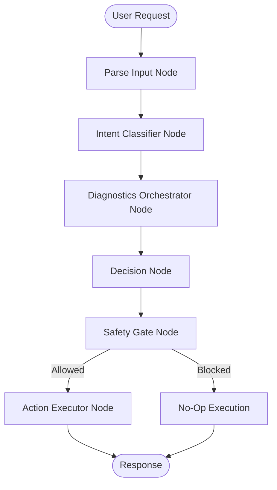

# SupportOps Agent

**SupportOps Agent** is an intelligent, autonomous support automation system that leverages Large Language Models (LLMs) and state-based workflows to automatically triage support tickets, run diagnostics, and execute safe remediation actions. Built with LangGraph and FastAPI, it provides a production-ready framework for automating technical support operations.

---

## 🎯 What is SupportOps Agent?

SupportOps Agent is an AI-powered support automation pipeline that processes customer support requests through a multi-stage workflow. The system:

1. **Parses & Validates** incoming support requests
2. **Classifies Intent** using LLM-based analysis
3. **Runs Diagnostics** by querying account databases and product simulators
4. **Makes Decisions** with rule-based and LLM-assisted logic
5. **Evaluates Safety** before taking any action
6. **Executes Actions** like creating tickets or collecting information

---

## 🏗️ Architecture Overview

The system is built on **LangGraph**, a state machine framework for orchestrating multi-step AI workflows. Each node in the graph represents a specific operation in the support pipeline.

### High-Level Flow Diagram



### Detailed Component Architecture

```
┌─────────────────────────────────────────────────────────────────┐
│                     FastAPI Application Layer                    │
│  (app/main.py - REST endpoints, health checks, frontend serving) │
└────────────────────────────┬────────────────────────────────────┘
                             │
                ┌────────────▼────────────┐
                │  LangGraph Triage Flow  │
                │  (langgraph_flow.py)   │
                └────────────┬────────────┘
                             │
         ┌───────────────────┼───────────────────┐
         │                   │                   │
    ┌────▼─────┐      ┌─────▼──────┐     ┌─────▼──────┐
    │  Nodes   │      │   Tools    │     │    LLMs    │
    │  Layer   │      │   Layer    │     │   Layer    │
    └──────────┘      └────────────┘     └────────────┘
         │                   │                   │
    ┌────▼─────────────────────────────────────▼────┐
    │           Storage & External Systems          │
    │   - MongoDB (Account & Audit DB)             │
    │   - Product Diagnostic Simulator             │
    │   - GitHub API (Ticket Creation)             │
    └──────────────────────────────────────────────┘
```

---

## 🔧 Node-by-Node Breakdown

### 1. **Parse Input Node** (`nodes.py::ParseInputNode`)

**Purpose**: Validates and normalizes incoming requests using Pydantic schemas.

**What it does**:
- Accepts raw JSON payload from API
- Validates required fields: `request_id`, `user_id`, `channel`, `message`
- Parses optional metadata: `product_version`, `timestamp`, `region`
- Returns a strongly-typed `triageRequest` model

**Why it's needed**: Ensures data quality before processing. Catches malformed requests early.

---

### 2. **Intent Classifier Node** (`nodes.py::IntentClassifierNode`)

**Purpose**: Uses LLM to classify the support ticket's intent, severity, and confidence.

**What it does**:
- Builds a prompt from the user message and metadata
- Calls LLM (OpenAI GPT-4 or MockLLM for testing) with JSON mode
- Extracts:
  - `intent`: e.g., "billing_issue", "technical_problem", "general_query"
  - `severity`: "low", "medium", "high"
  - `confidence`: 0.0 to 1.0
  - `explanation`: Reasoning for the classification
  - `issues`: Whether specific issues were detected

**Why it's needed**: Provides semantic understanding of the customer's problem, which feeds into decision-making logic.

**Example Prompt**:
```
You are a support triage assistant. Return a JSON object with keys: 
intent, severity, confidence, explanation, issues.

Customer message: "My payment keeps failing with timeout errors"
Account metadata: {"product_version": "v2.1", "region": "us-west"}
```

---

### 3. **Diagnostics Orchestrator Node** (`diag_nodes.py::DiagnosticsOrchestratorNode`)

**Purpose**: Fetches contextual data from account databases and product systems.

**What it does**:
- Calls `AccountTool` to fetch user account details (subscription, payment history)
- Calls `ProductDiagTool` to run product-specific diagnostics (service health, gateway status)
- Merges results into a unified diagnostics dictionary

**Tools Used**:
- **AccountTool**: Queries MongoDB account database
- **ProductDiagTool**: Queries product diagnostic simulator
- **CombinedDiagnosticsTool**: Orchestrates both

**Why it's needed**: Provides factual context about the user's account state and product health, enabling data-driven decisions.

**Output Structure**:
```json
{
  "account_state": {
    "user_id": "user123",
    "subscription": "premium",
    "last_payment_attempt": "2026-01-05T10:00:00Z"
  },
  "product_diagnostics": {
    "service_health": "healthy",
    "payment_gateway_status": "timeout"
  }
}
```

---

### 4. **Decision Node** (`diag_nodes.py::DecisionNode`)

**Purpose**: Combines rule-based logic with LLM reasoning to recommend actions.

**What it does**:
- Evaluates diagnostics and classification results using hardcoded rules
- Determines `recommended_action` (e.g., "create_ticket", "collect_account_info")
- Assigns `severity` and `runbook_id`
- Uses LLM to generate:
  - **Justification**: Why this action was chosen
  - **Runbook Summary**: Steps involved in the recommended runbook

**Rule Examples**:
- **Rule 1**: If `payment_gateway_status == "timeout"` → create support ticket
- **Rule 2**: If account has no subscription → collect account info
- **Rule 3**: If service is healthy → suggest general runbook

**Why it's needed**: Bridges automated detection with actionable next steps. LLM justifications improve transparency.

**Output Structure**:
```json
{
  "recommended_action": {
    "type": "create_ticket",
    "summary": "Payment gateway timeout detected",
    "body": "User user123 experiencing payment timeout...",
    "action_payload": {"ticket_labels": ["billing", "high-severity"]}
  },
  "severity": "high",
  "runbook_id": "payment_retry_flow_v1",
  "justification": "Payment gateway timeout requires immediate investigation.",
  "runbook_summary": "1. Check gateway logs\n2. Retry payment\n3. Escalate if needed"
}
```

---

### 5. **Safety Gate Node** (`safety.py::SafetyGateNode`)

**Purpose**: Enforces safety policies and audit trail requirements before executing actions.

**What it does**:
- Categorizes actions into **non-destructive** and **destructive**
  - **Non-destructive** (auto-allowed): `create_ticket`, `collect_account_info`, `suggest_runbook`
  - **Destructive** (requires approval): `reset_credentials`, `delete_account`
- Creates audit records in MongoDB
- Generates HMAC-based audit tokens for allowed actions
- Returns approval requirements for blocked actions

**Why it's needed**: Prevents unauthorized or dangerous actions. Creates compliance audit trail.

**Output Structure** (Allowed):
```json
{
  "action_allowed": true,
  "audit_id": 12345,
  "audit_token": "a3f8d9e...",
  "status": "allowed",
  "required_approvals": []
}
```

**Output Structure** (Blocked):
```json
{
  "action_allowed": false,
  "audit_id": 12346,
  "status": "requires_approval",
  "required_approvals": ["human_support_agent"]
}
```

---

### 6. **Action Executor Node** (`executor.py::ActionExecutorNode`)

**Purpose**: Executes approved actions via external tools.

**What it does**:
- Checks if action is allowed (from Safety Gate)
- If allowed and action type is `create_ticket`:
  - Calls `TicketTool` (local) or `GitHubTicketTool` (GitHub API)
  - Creates issue with title, body, and labels
- Updates audit record status to "executed"
- Returns execution result with external API response

**Why it's needed**: Final step that translates decisions into real-world actions (ticket creation, etc.).

**Tools Used**:
- **GitHubTicketTool**: Creates GitHub issues via API
- **TicketTool**: Local fallback for testing

---

## 🛠️ Tech Stack

- **Core**: Python 3.12+
- **API Framework**: FastAPI
- **AI/LLM**: LangChain, LangGraph, OpenAI GPT-4
- **State Machine**: LangGraph StateGraph
- **Database**: MongoDB (via PyMongo)
- **External APIs**: GitHub REST API
- **Testing**: Pytest
- **Containerization**: Docker

---

## 📂 Project Structure

```
Supportops_agent/
├── app/
│   ├── graph/              # LangGraph workflow orchestration
│   │   ├── langgraph_flow.py   # Main flow: wires all nodes together
│   │   ├── nodes.py            # Parse & Classify nodes
│   │   ├── diag_nodes.py       # Diagnostics & Decision nodes
│   │   ├── safety.py           # Safety Gate node
│   │   └── executor.py         # Action Executor node
│   ├── tools/              # External integration tools
│   │   ├── diag_tools.py       # Account & Product diagnostic tools
│   │   ├── ticket_tool.py      # Local ticket tool (fallback)
│   │   └── github_ticket_tool.py # GitHub API integration
│   ├── llm/                # LLM abstractions
│   │   └── mock_llm.py         # Mock LLM for testing
│   ├── db/                 # Database access layers
│   │   ├── account_mongo.py    # Account DB queries
│   │   └── audit_mongo.py      # Audit trail persistence
│   ├── simulator/          # Test data simulators
│   │   └── diag_simulator.py   # Product diagnostic simulator
│   ├── schemas.py          # Pydantic request/response models
│   ├── main.py             # FastAPI application & endpoints
│   └── logging_utils.py    # Centralized logging config
├── tests/                  # Pytest test suite
├── frontend/               # React-based web UI
├── scripts/                # Smoke tests and utilities
├── Dockerfile              # Container build configuration
└── pyproject.toml          # Python dependencies
```

## 🔄 Data Flow Example

Let's trace a real support request through the system:

**Input**:
```json
{
  "request_id": "REQ-001",
  "user_id": "user_abc",
  "channel": "email",
  "message": "My payment keeps timing out when I try to upgrade",
  "metadata": {
    "product_version": "v2.1",
    "region": "us-west"
  }
}
```

**Flow**:
1. **Parse**: Validates request structure → returns `triageRequest` model
2. **Classify**: LLM identifies `intent="billing_issue"`, `severity="high"`, `confidence=0.92`
3. **Diagnostics**: 
   - AccountTool finds user has active subscription
   - ProductDiagTool detects `payment_gateway_status="timeout"`
4. **Decision**: Rule triggers: "payment timeout → create ticket"
   - LLM generates justification and runbook summary
5. **Safety**: Action "create_ticket" is non-destructive → auto-approved
   - Audit record created with status "allowed"
6. **Execute**: GitHubTicketTool creates issue #123 with labels ["billing", "high-severity"]
   - Audit record updated to "executed"

**Output**:
```json
{
  "execution": {
    "executed": true,
    "external_response": {
      "issue_number": 123,
      "url": "https://github.com/org/repo/issues/123"
    },
    "audit": {
      "id": 12345,
      "status": "executed",
      "audit_token": "a3f8d9e..."
    }
  }
}
```

---

## 🚀 Getting Started

### Prerequisites

- Python 3.12 or higher
- Docker (optional, for containerized execution)
- OpenAI API Key
- MongoDB URI (or use the mock setup for testing)

### Local Development Setup

1.  **Clone the repository:**
    ```bash
    git clone https://github.com/nidish124/Supportops_agent.git
    cd Supportops_agent
    ```

2.  **Create and activate a virtual environment:**
    ```bash
    python -m venv .venv
    # Windows
    .venv\Scripts\activate
    # macOS/Linux
    source .venv/bin/activate
    ```

3.  **Install dependencies:**
    ```bash
    pip install -r requirements.txt
    # OR using uv/pip tools if applicable based on pyproject.toml
    pip install .
    ```

4.  **Configure Environment:**
    Create a `.env` file in the root directory (copy from default or set manually):
    ```env
    OPENAI_API_KEY=your_openai_api_key
    MONGO_URI=mongodb://localhost:27017/supportops
    GITHUB_TOKEN=your_github_pat  # Optional: for GitHub integration features
    ```

### ▶️ Running the Application

**Using Uvicorn (Local):**

```bash
uvicorn app.main:app --reload
```

The API will be available at `http://localhost:8000`.
Explore the interactive API docs at `http://localhost:8000/docs`.


**Using Docker:**

```bash
docker build -t supportops-agent .
docker run -p 8000:8000 --env-file .env supportops-agent
```

### 🖥️ Running the Frontend

Navigate to the `frontend` directory and start the development server:

```bash
cd frontend
npm install  # First time only
npm run dev
```

The frontend will be available at `http://localhost:5173`.
It is configured to proxy API requests to `http://localhost:8000`. Ensure the backend is running.

## 🧪 Testing

Run the comprehensive test suite using `pytest`:

```bash
# Run all tests
pytest

# Run specific test categories
pytest tests/test_nodes.py              # Node-level tests
pytest tests/test_integration.py        # End-to-end flow tests
pytest tests/test_safety_gate.py        # Safety policy tests
pytest tests/test_executor_github.py    # GitHub integration tests

# Run with coverage
pytest --cov=app --cov-report=html
```

**Test Structure**:
- **Unit Tests**: Individual node behavior (mock LLM, deterministic)
- **Integration Tests**: Full flow with MongoDB (requires local MongoDB)
- **Smoke Tests**: Production readiness checks (`scripts/smoke_test.py`)

---

## 🔑 Environment Variables

Create a `.env` file in the root directory:

```env
# Required for LLM-based classification and decision-making
OPENAI_API_KEY=sk-...

# MongoDB connection (optional: uses in-memory mock if not provided)
MONGO_URI=mongodb://localhost:27017/supportops

# GitHub integration (optional: falls back to local ticket tool)
GITHUB_TOKEN=ghp_...
GITHUB_REPO=owner/repo

# Safety & Audit
AUDIT_SECRET=your-secret-key  # For HMAC audit token generation
```

**Fallback Behavior**:
- No `OPENAI_API_KEY` → Uses `MockLLM` (deterministic responses)
- No `GITHUB_TOKEN` → Uses local `TicketTool` (in-memory)
- No `MONGO_URI` → Uses in-memory MongoDB simulation

---

## 🌐 API Endpoints

### **POST** `/triage`
Main triage endpoint for processing support requests.

**Request**:
```json
{
  "request_id": "REQ-123",
  "user_id": "user_abc",
  "channel": "slack",
  "message": "Can't access my account",
  "metadata": {
    "product_version": "v3.0"
  }
}
```

**Response**:
```json
{
  "classification": {...},
  "diagnostics": {...},
  "decision": {...},
  "safety": {...},
  "execution": {...}
}
```

### **GET** `/health`
Basic health check (always returns `{"status": "ok"}`).

### **GET** `/ready`
Readiness probe: Validates full system wiring (initializes LangGraph flow).

### **GET** `/docs`
Interactive API documentation (Swagger UI).

---

## 🐳 Docker Deployment

**Build and run**:
```bash
# Build image
docker build -t supportops-agent .

# Run container
docker run -p 8000:8000 --env-file .env supportops-agent

# With MongoDB
docker-compose up  # (if docker-compose.yml exists)
```

**Dockerfile highlights**:
- Multi-stage build for optimized image size
- Non-root user for security
- Health checks configured

---

## 🎨 Frontend

A React-based UI is available in the `frontend/` directory.

**Setup**:
```bash
cd frontend
npm install
npm run dev
```

**Access**: `http://localhost:5173` (proxies API requests to `http://localhost:8000`)

**Features**:
- Submit support tickets via web form
- View real-time triage results
- Inspect classification, diagnostics, and execution details

---

## 🔐 Security & Compliance

### Audit Trail
Every action attempt is logged in MongoDB with:
- Request ID, User ID, Timestamp
- Action type and payload
- Executor ID (system or human)
- Status progression: `allowed` → `executed` / `rejected`
- HMAC audit token for verification

### Safety Policies
- **Non-destructive actions** (create tickets, collect info) → Auto-approved
- **Destructive actions** (reset credentials, delete account) → Require human approval
- All actions logged before execution
- Executor authorization checks for high-risk operations

### Data Privacy
- No PII logged in audit trail (only user IDs)
- MongoDB access controlled via connection string
- API key rotation supported via environment variables

---

## 📈 Monitoring & Observability

**Logging**:
- Centralized logging via `logging_utils.py`
- Structured logs with request IDs for tracing
- Log levels: INFO (flow), DEBUG (diagnostics), ERROR (failures)

**Metrics** (future):
- Track success/failure rates by action type
- Monitor LLM latency and token usage
- Alert on audit policy violations

---

## 🛠️ Development Workflow

### Adding a New Action Type

1. **Define action in Decision Node** ([diag_nodes.py](app/graph/diag_nodes.py#L55-L90))
   ```python
   elif some_condition:
       recommended_action = {
           "type": "new_action_type",
           "summary": "Action summary",
           "body": "Details...",
           "action_payload": {...}
       }
   ```

2. **Configure safety policy** ([safety.py](app/graph/safety.py#L27-L28))
   ```python
   self.non_destructive.add("new_action_type")  # or self.destructive
   ```

3. **Implement execution logic** ([executor.py](app/graph/executor.py#L45-L60))
   ```python
   elif action_type == "new_action_type":
       # Execute action via external tool
       result = self.tool.execute(payload)
       # Update audit and return
   ```

4. **Add tests** ([tests/test_executor.py](tests/test_executor.py))

### Adding a New Diagnostic Source

1. **Create tool** in [tools/diag_tools.py](app/tools/diag_tools.py)
2. **Wire into** [CombinedDiagnosticsTool](app/tools/diag_tools.py#L32-L40)
3. **Update Decision Node rules** to consume new diagnostic data

---

## 📚 Key Design Decisions

### Why LangGraph?
- **State persistence**: Each node updates a shared state dictionary
- **Conditional routing**: Safety gate dynamically routes to execute or block
- **Testability**: Nodes are isolated, injectable functions
- **Debuggability**: State snapshots at each step

### Why Rule-Based + LLM Hybrid?
- **Rules**: Deterministic, fast, auditable for known scenarios
- **LLM**: Flexible reasoning, justifications, edge case handling
- **Hybrid**: Best of both worlds with graceful fallback

### Why Mock LLM for Tests?
- **Determinism**: Tests don't flake due to LLM variability
- **Cost**: Zero API calls during CI/CD
- **Speed**: Instant responses vs. network latency
- **Production**: Real LLM enabled via `OPENAI_API_KEY` env var

---

## 🤝 Contributing

1. Fork the repository
2. Create a feature branch: `git checkout -b feature/new-action`
3. Write tests for new functionality
4. Run test suite: `pytest`
5. Submit pull request with clear description

**Code Style**:
- Follow PEP 8
- Use type hints (`typing` module)
- Pydantic models for all data structures
- Docstrings for public functions

---

## 📄 License

This project is licensed under the MIT License.

---

## 🔗 Related Resources

- [LangGraph Documentation](https://langchain-ai.github.io/langgraph/)
- [FastAPI Documentation](https://fastapi.tiangolo.com/)
- [OpenAI API Reference](https://platform.openai.com/docs/api-reference)
- [MongoDB Python Driver](https://pymongo.readthedocs.io/)

---

**Built with ❤️ by the SupportOps Team**